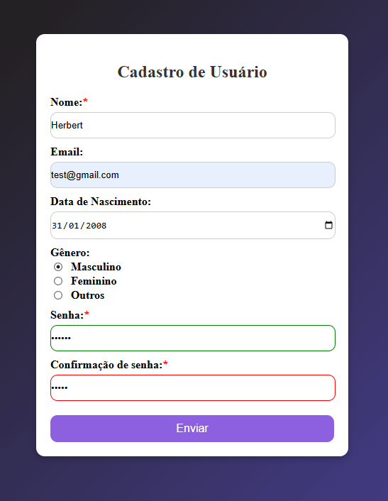

# Cadastro de Usuário

Formulário responsivo feito com HTML, CSS e JavaScript para praticar eventos, manipulação do DOM e validação de campos. O preenchimento e a validação acontecem no navegador.

[Experimentar no GitHub Pages](https://herbertfariasss.github.io/cadastro-de-usuario/)



## Como executar

Clone o repositório e abra [`index.html`](index.html) no navegador.

```bash
git clone https://github.com/herbertfariasss/cadastro-de-usuario.git
cd cadastro-de-usuario
```

Preencha os campos obrigatórios e digite uma senha com pelo menos seis caracteres. A confirmação precisa coincidir com a senha. Ao validar o formulário, a página exibe uma mensagem de sucesso e limpa os campos. O formulário simula um cadastro e descarta os valores após a validação.

## Estrutura

- [`index.html`](index.html) contém o formulário.
- [`css/`](css/) contém os estilos e as regras de responsividade.
- [`js/script.js`](js/script.js) valida a senha e trata o envio.
